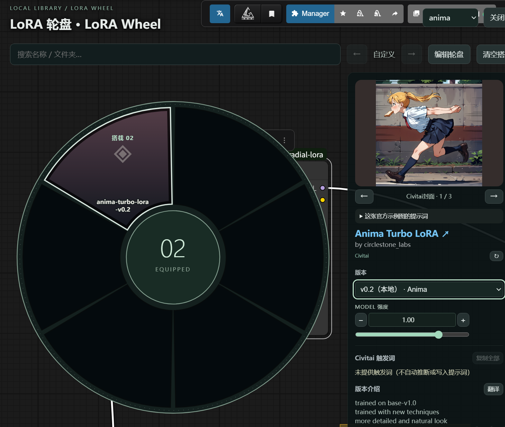
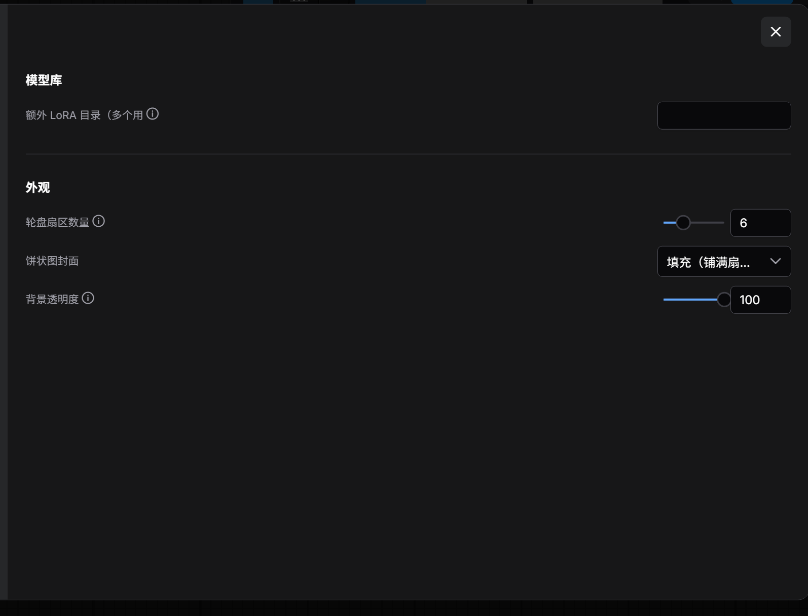
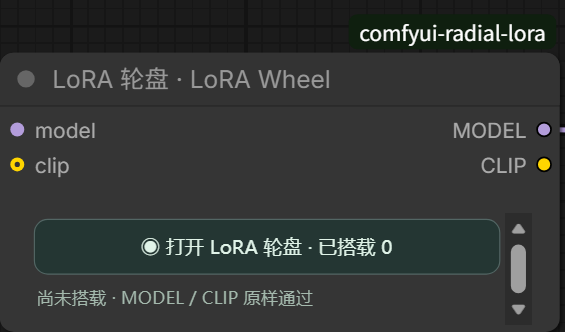
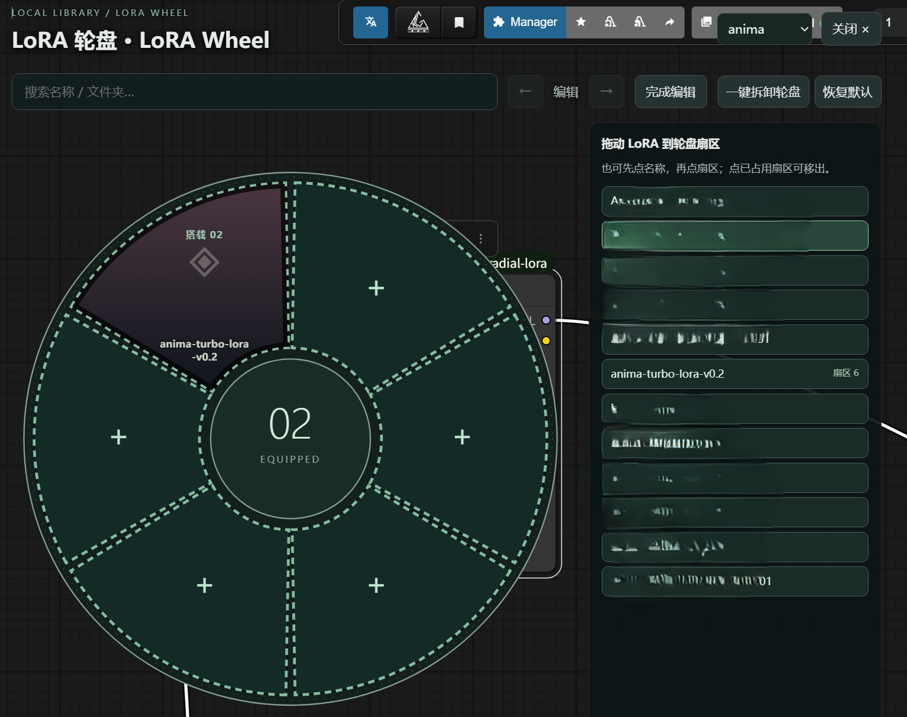

# ComfyUI LoRA 轮盘 · LoRA Wheel

这是 ComfyUI 自定义节点插件，不是 LoRA 模型。在现有 ComfyUI 中按封面挑选 LoRA：点击轮盘扇区搭载或卸载，并直接在工作流节点中调整强度。

插件提供可执行的 `RadialLoraStack` 节点；不需要另一套 ComfyUI，也不替换原生 `LoraLoader`。运行时仅使用 ComfyUI 已有的 Python 依赖；前端使用原生 DOM、SVG 和扩展 API，无构建步骤。

## 界面预览

[](docs/screenshots/wheel.png)

<details>
<summary>查看设置、节点和编辑轮盘界面</summary>

### 设置界面



### 节点样式



### 编辑轮盘



</details>

截图来自当前本地预览版：编辑图中的 LoRA 名单已打码，轮盘图使用 Anima 官方 LoRA 演示。仓库和离线安装包均不包含该模型文件；离线安装包也不包含演示截图。

当前为 GitHub 公开预览版；尚未发布 GitHub Release，也未提交 ComfyUI Registry。可使用下方 Git 命令或 GitHub 页面的 **Code → Download ZIP** 安装。

## 安装

将插件文件夹放入**现有** ComfyUI 的 `custom_nodes`，然后重启 ComfyUI 并刷新浏览器。安装包不包含模型，也不需要额外安装 Python 依赖。

下载 ZIP 时，先解压，再把解压出的插件文件夹放到 `ComfyUI/custom_nodes/`；确认该文件夹内直接有 `__init__.py`、`civitai.py` 和 `web/`，不要多套一层文件夹。不要把 ZIP 直接拖到 ComfyUI 画布，也不要把模型复制到插件目录。

推荐用 Git 安装：

```bash
cd /path/to/ComfyUI/custom_nodes
git clone https://github.com/blyb8634/comfyui-lora-wheel-plugin.git comfyui-lora-wheel-plugin
```

English quick start: extract the plugin folder into your existing `ComfyUI/custom_nodes/` directory, restart ComfyUI, then search for **LoRA Wheel**. The folder must contain `__init__.py` directly; no models or extra Python packages are bundled.

更新时先关闭 ComfyUI，仅替换此插件文件夹中的代码文件并保留自己的模型和工作流，随后重启并刷新浏览器。卸载时关闭 ComfyUI，移走 `custom_nodes` 下的插件文件夹；曾使用本节点的工作流在卸载后会提示缺少 `RadialLoraStack`，请先保留工作流备份。可选地清理 ComfyUI 用户目录下的 `radial_lora/` 缓存与额外路径配置；这不是模型目录，不要误删模型。

在节点搜索中添加 `LoRA 轮盘 · LoRA Wheel`，将 MODEL（可选 CLIP）接到节点输入，再把对应输出接向采样器／文本编码节点。内部类型仍是 `RadialLoraStack`，旧工作流可继续加载。点击节点内按钮打开轮盘；选择结果保存在节点的工作流数据里。节点右下角可拖动调整尺寸，重新打开工作流时保留手动尺寸。空搭载直接透传。若原工作流已加载同一个 LoRA，避免重复连接。

## 功能

- 轮盘默认六等分，可在设置中选 4–10 个等分扇区：同名本地封面、名称、搭载／卸载的压入反馈；可搜索、分页、按子文件夹筛选。扇区越多，封面与名称越紧凑。封面模式可设为等比缩小或尽量填充。
- 大图封面按需生成最长边 1024 像素的 WebP 预览，缓存在 ComfyUI 用户目录的 `radial_lora/covers/`；原封面、模型文件和工作流不会因此被修改。损坏或过大的封面只影响预览，不影响搭载。缓存超过 512 MB 或 4000 个文件时按最旧优先清理；Civitai 查询缓存上限为 64 MB／3000 个文件。
- 点击“编辑轮盘”可把当前文件夹的 LoRA 从右侧名单拖到扇区替换；也可先点名单再点扇区。编辑时点已占用扇区可单独移出，“一键拆卸轮盘”只清空当前文件夹轮盘，不卸载工作流中已搭载的 LoRA；“恢复默认”回到自动分页。各文件夹布局和最后所选文件夹保存在当前节点的工作流属性中，重新打开仍保留。
- 节点内紧凑显示已搭载项和 MODEL 强度，可用滑块、数值框或 ±0.01 按钮调整，也可用红色 × 快速卸载。轮盘右侧也只显示 MODEL 强度；搭载／卸载在扇区上点击完成。旧工作流已保存的 CLIP 强度保持原执行值，新搭载项默认 CLIP 强度为 1，不暗中改写原有工作流。
- ComfyUI 设置中可调轮盘背景透明度（0–100）、封面模式及多个额外 LoRA 目录。默认目录始终保留；额外目录配置写入 ComfyUI 用户目录下的 `radial_lora/paths.json`，不会修改 `extra_model_paths.yaml`、模型或工作流文件。
- 悬停后自动按本地文件 SHA-256 匹配公开 Civitai 模型；若模型旁有 `.civitai.info` 且其中记录的 SHA-256 与文件大小吻合，直接复用该哈希，跳过整文件读取；哈希未被收录时自动回退为本地计算。显示作者、版本、本地／官方封面、示例图片提示词与作者介绍。介绍优先显示所选版本的说明，缺失时显示模型整体介绍，不重复堆叠两段。版本切换仅查看资料，不替换本地已搭载文件。未匹配或联网失败时继续使用本地资料。
- Civitai 版本选择仅查看资料与官网链接，不下载或替换本地模型；旧版保存于当前浏览器的下载 Token 会在下次打开轮盘时清除。
- Civitai 站点可在设置中切换：默认镜像 `civitai.red`，可改回官方 `civitai.com`，或填写其他兼容站点的完整 HTTPS 地址（本机代理可用 HTTP）；查询与发布页链接随之切换，已缓存结果的链接自动跟随。
- 官网提供触发词时只显示官网词；否则显示本地词。每个词及全部词均可复制。作者介绍按需翻译，可切回原文。

匹配只向当前设置的 Civitai 站点发送 SHA-256，不上传模型文件或本地路径；发布页链接指向同一站点，封面仍使用接口返回的 Civitai 图片地址。站点默认为镜像 `civitai.red`，可在 ComfyUI 设置中切换为官方 `civitai.com` 或自定义兼容站点，配置保存在 ComfyUI 用户目录的 `radial_lora/site.json`。查询缓存位于 ComfyUI 用户目录的 `radial_lora/civitai/`，切换站点后已缓存的结果与链接会自动指向新站点。公开接口可能因网络、限流、权限或文件哈希未收录而无法匹配。插件不下载模型，也不自动写入提示词。

本插件面向受信任的本地 ComfyUI。若将 ComfyUI 开放给其他人，须先在服务入口配置身份验证与访问控制；同源检查只防跨站请求，不是用户认证。获得 ComfyUI 访问权限的人也可使用额外 LoRA 路径设置。首次处理超大封面可能暂时占用较多内存，后续优先读取缓存预览。

## 翻译部署

默认点击“翻译”会先尝试本插件的服务端翻译接口。若部署者未配置翻译服务，则回退到支持 `Translator` API 的浏览器；首次使用可能在该浏览器下载语言包。

如果不希望每个访问者下载语言包，可在**启动 ComfyUI 的进程环境**配置一个兼容 [LibreTranslate API](https://docs.libretranslate.com/) 的服务：

```text
RADIAL_LORA_TRANSLATE_URL=https://your-translation-service.example
RADIAL_LORA_TRANSLATE_KEY=your-optional-api-key
```

服务端调用 `POST /translate`，仅发送当前点击翻译的介绍文字；语言参数为 `source=auto,target=zh`。URL 可填服务根地址或完整 `/translate` 地址。公网服务必须使用 HTTPS；本机服务可使用 HTTP `localhost`／`127.0.0.1`。密钥只保存在部署环境，不应提交到仓库或工作流。一个服务供所有访问者使用，可自托管（语言模型只需服务端准备一次）或选择托管服务；托管服务的配额／费用由部署者负责。服务不可用时会提示错误；未配置时才尝试浏览器翻译。启用后重启现有 ComfyUI。

## 测试

在已安装 ComfyUI Python 依赖的环境中运行：

```bash
python test_backend.py
python test_civitai.py
```

可选浏览器回归测试：本机安装测试工具 `playwright` 和 Chromium 后运行 `node test_online_ui.cjs`。如需使用系统 Chrome，设置环境变量 `CHROME_PATH`。该测试只启动静态文件服务与模拟 API，不启动另一套 ComfyUI，不接触模型或工作流。

在仓库根目录运行 `python package_release.py` 可生成 `dist/comfyui-lora-wheel.zip`。压缩包只包含插件运行文件、README 和 LICENSE，不包含测试、本机截图、模型、工作流或缓存；生成后可按上面的 ZIP 安装步骤检查文件夹层级。

插件不依赖其他 LoRA 插件，不修改 ComfyUI 核心或 LiteGraph 原型。节点选择最多 32 个 LoRA；模型文件仍由原生 `LoraLoader` 按顺序加载。

问题和改进建议可提交到本仓库的 GitHub Issues；提交代码前请阅读 [贡献说明](https://github.com/blyb8634/comfyui-lora-wheel-plugin/blob/main/CONTRIBUTING.md)。安全问题请按 [安全说明](https://github.com/blyb8634/comfyui-lora-wheel-plugin/blob/main/SECURITY.md)私密报告。代码采用 [MIT 许可证](LICENSE)。
